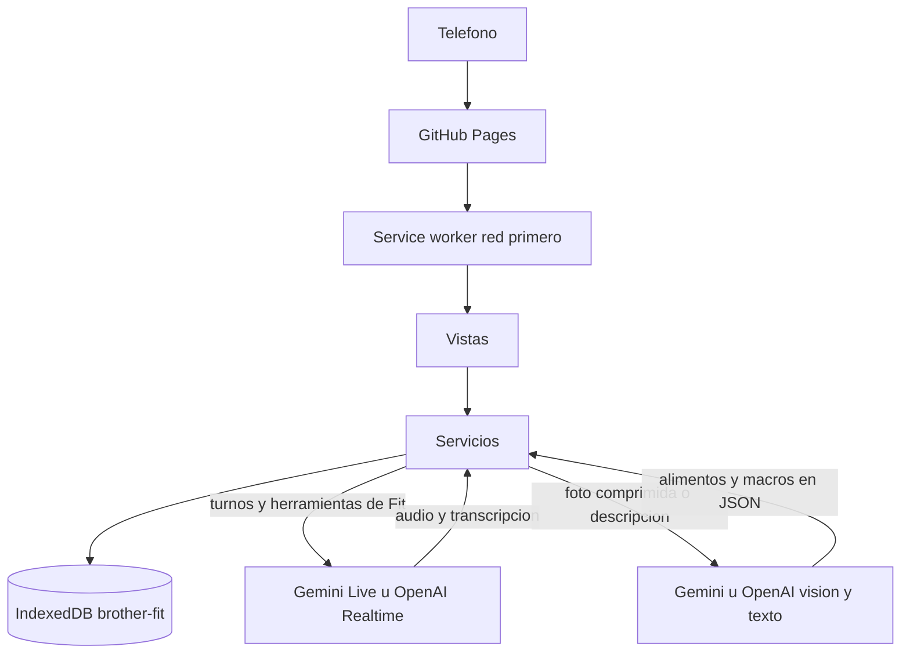

# Brother Fit — sistema

Documento vivo del producto. Describe cómo está armado, dónde vive cada dato y qué no se puede romper. Cuando cambie el comportamiento, el esquema, una pantalla o la forma de publicar, este archivo se actualiza en el mismo cambio.

Última revisión: 15 de noviembre de 2026. Base de datos versión 3. Caché de la app `v184`.

## Qué es

Brother Fit es una aplicación web progresiva para registrar entrenos, peso corporal, creatina y comidas en el teléfono. Los datos del atleta viven en el navegador, no en un servidor propio. Lo único que sale del teléfono son las llamadas a IA, y solo si el atleta pegó su clave: Fit (voz y texto en directo) y el análisis de comidas por foto o por texto. Proveedores: Gemini u OpenAI.

## Rumbo

El objetivo es publicar Brother Fit en **Google Play Store**. Toda decisión de arquitectura, datos, permisos y privacidad se toma pensando en pasar la revisión de Play y en atletas que no son el autor: nada de datos personales sembrados en el código, claves y permisos explicados, y datos que se pueden exportar y borrar.

Se usa con una mano, en vertical, con fondo negro y amarillo eléctrico. El nombre público de la app instalada es «Brother Fit».

- Repositorio: https://github.com/danieth-dev/Brother-Fit.git
- Teléfono: https://danieth-dev.github.io/Brother-Fit/
- Local: desde la carpeta del proyecto, `python -m http.server 8000` y abrir `http://127.0.0.1:8000`. No se abre como archivo suelto: los módulos y el service worker lo exigen.

No hay paso de compilación. El navegador carga HTML, CSS y módulos de JavaScript tal cual están en el repositorio.

## Cómo se actualiza este archivo

Se toca en el mismo cambio que modifica el sistema. No es un diario de cada ajuste visual. Sí se reescribe cuando cambia alguna de estas cosas:

- una pantalla, su ruta o lo que el atleta puede hacer ahí
- una tabla, un campo, un índice o `DB_VERSION`
- una regla de negocio (descanso, semilla de ejercicios, 1RM, creatina, Fit)
- la forma de publicar, la caché o el modelo de voz
- una decisión que, si se olvida, borra datos o duplica historial

## Arquitectura

Las vistas dibujan y escuchan. Los servicios deciden y calculan. `js/db.js` es el único módulo que abre IndexedDB. Las vistas no leen ni escriben tablas por su cuenta. Las claves y el proveedor de IA se leen y escriben con `getAgentConfig()` / `setAgentConfig()` de `js/services/agent.js`, y `js/services/meals.js` las reutiliza para el análisis de comidas.

```
index.html
  └─ js/main.js          abre la base, siembra ejercicios, carga ajustes, arranca el router
       ├─ js/db.js       IndexedDB brother-fit
       ├─ js/store.js    ajustes en memoria
       ├─ js/router.js   hash → vista
       └─ js/utils/picker.js   listas propias, fuera de #app
            └─ js/views/*       llaman a js/services/*
                 └─ js/services/*   llaman a db
```

Al navegar, el router crea un `<section class="view">` nuevo y tira el anterior. Los listeners y temporizadores de esa pantalla mueren con ella. Si el atleta cambia de ruta mientras una vista todavía está cargando, el resultado viejo se descarta.

La pantalla de entreno se vuelve a dibujar sola al añadir o borrar una serie, sin pasar por el router. El observador de `watchPickers` vuelve a enganchar los `<select>` después de cada reemplazo del HTML.



## Arranque

1. Se bloquea el tirón de recarga de Chrome solo cuando el documento está arriba y ninguna lista interna puede seguir subiendo.
2. Se abre IndexedDB. Si falla, la app avisa y no sigue. Suele pasar en navegación privada.
3. Se recupera la pregunta de esfuerzo pendiente (`loadPending()`).
4. `ensureSeed()` añade los ejercicios del catálogo que todavía no existen. Un nombre ya guardado no se toca y su historial sigue en el mismo id.
5. Datos de prueba: con `?fixtures`, `?test` o `?seed` en la URL, o en `localhost` con la base sin entrenos ni tomas, se restaura `fixtures/latest-backup.json` (carpeta fuera de git). Si el atleta usó «Borrar todo», `localStorage.brother_fit_cleared` evita que vuelvan a cargarse solos.
6. Se leen los ajustes y se aplican modo (oscuro/claro/sistema) y color de acento.
7. Se observan `#app` para sustituir `<select>`, fechas y horas por hojas propias y para activar el arrastre de los `.seg`.
8. El router pinta la ruta del hash.
9. Se pide almacenamiento persistente para que el navegador no borre los datos por falta de espacio.
10. Se registra `sw.js` y se reanudan los recordatorios de agua (también al volver la app a primer plano). Cuando un service worker nuevo toma el control, la página se recarga sola.

## Pantallas

La barra es una isla fija abajo con Inicio, Entreno y Progreso. Historial, creatina, comidas y ajustes cuelgan de Inicio. Aspecto cuelga de Ajustes. Fit cuelga de Entreno y, mientras está abierto, la isla se oculta (`body.in-agent-view`). Una pulsación larga en cualquier vínculo o botón **nunca** debe abrir el menú del navegador (copiar vínculo, compartir, abrir en Brave): `main.js` cancela `contextmenu` y `dragstart` en captura (salvo campos de texto), marca `draggable=false` en los `<a>` también tras cada repintado, y `base.css` aplica `-webkit-touch-callout: none` a botones, filas, disco, chips y `[data-action]`. Regla de agente: `.cursor/rules/no-browser-link-menu.mdc`.

Los `<select>` de ejercicio, grupo muscular y descanso no usan el menú del sistema. Un botón abre una hoja inferior con la misma paleta. El `<select>` real sigue en el formulario: al elegir, se escribe su valor y se dispara `change`, así que las vistas no saben que la lista es propia. La hoja vive en `document.body`, fuera de `#app`, y se cierra al elegir, al cambiar de ruta o si el control desaparece.

El día del peso corporal y el de una toma de creatina usan la misma hoja, con el mes en curso y el día elegido en amarillo. El `input type="date"` sigue en el formulario y recibe la fecha. El calendario del teléfono no se abre.

| Ruta | Pantalla | Qué hace |
| --- | --- | --- |
| `#/` | Inicio | Creatina de hoy, la semana en siete días (amarillo si hubo entreno), tarjeta de entreno (empezar o continuar), anillo de calorías del día con enlace a Comidas y últimos entrenos. Cada entreno abre `#/history/:id`. |
| `#/workout` | Entreno | Una sesión abierta. Si no hay ninguna, el botón la crea. Peso, reps, tipo de serie y esfuerzo; encima del peso, la sesión anterior completa, para repetirla o pasarla. Si ya la pasaste, lo dice y parte del último peso. Las series de hoy van en un pliegue. La lista de ejercicios pone primero los de hoy, y se recorta por nombre o por grupo muscular. Descanso, alta de ejercicio y corrección desde esa lista. |
| `#/history` y `#/history/:id` | Historial | Lista por semanas con filtro por grupo muscular, y detalle. En el detalle se edita una serie (peso, reps, tipo, esfuerzo) y se enlaza al progreso del ejercicio. Borrar un entreno borra también sus series. |
| `#/progress` y `#/progress/:id` | Progreso | Dos pestañas. Ejercicio: PR, comparativa, gráfica (1RM estimado, ajustado, peso máximo, volumen) y tabla. Peso corporal: registro, gráfica y lista. |
| `#/meals` | Comidas | Anillo de calorías y barras de proteína, carbos y grasa del día frente a la meta; objetivo (ganar, mantener, definir) que recalcula la meta con el último peso corporal; lista de comidas del día con su tipo y proteína (tocar una la edita); escanear foto, añadir a mano o pedir a Fit. |
| `#/creatine` | Creatina | Disco + racha, calendario, progreso/ciencia en pliegue, últimas 5 tomas (+ pliegue «Ver todas»). |
| `#/agent` | Fit AI | Voz en directo y caja de texto, con botón de cámara para escanear comida. Sin clave, solo pide la clave. Panel «Recuerdos»: perfil (nombre, peso, estatura, creatina), rutina semanal, notas y entrenos. Panel «Conexión y API key»: proveedor (Gemini u OpenAI), claves y estado. La charla se guarda en el teléfono; Nuevo chat la borra tras confirmar. |
| `#/settings` | Ajustes | Cinco grupos: Preferencias (Aspecto, descanso, recordatorios de agua), Asistente Fit (Recuerdos y Conexión), Datos y respaldo, Aplicación (instalar) y Zona de riesgo (borrar todo). |
| `#/appearance` | Aspecto e inicio | Modo de pantalla (oscuro, claro o sistema), color de acento (amarillo, azul o rosado) y vista del disco de creatina en Inicio (completo o compacto al tomar). |

Si el ejercicio tiene grupo muscular, el nombre lo lleva debajo, en letra pequeña y con un punto de color. También queda bajo el campo ya elegido y junto al nombre en las series registradas. El grupo `Otro` no se muestra: no nombra un músculo. Cuando el grupo se queda corto, la misma línea sigue con la parte concreta en minúscula, por ejemplo «PIERNAS · cuádriceps y glúteo». Eso se ve al elegir y bajo el campo. En las series ya registradas sigue solo el grupo.

Un ejercicio es del atleta cuando su nombre no está en el catálogo. En la lista, esa fila lleva un lápiz justo antes del círculo y fuera de la cápsula amarilla. El nombre sigue eligiendo. El lápiz abre la ficha «Editar ejercicio» (nombre y grupo). Eliminar está en esa ficha, no en la fila: si hay series, la confirmación dice cuántas y se borran con el ejercicio en la misma operación. El catálogo no lleva lápiz. La ficha vive en `document.body`, como las otras hojas.

## Datos

Base `brother-fit`, versión 3 (la 3 añadió `meals`). Para una tabla o un índice nuevo se sube `DB_VERSION` y se añade un bloque `if (old < N)` en `migrate()`. No se sube la versión por un cambio de pantalla.

| Tabla | Qué guarda |
| --- | --- |
| `exercises` | `{ id, nombre, grupo }`. El nombre es único. No hay campo de dueño: es del atleta si el nombre no está en el catálogo. |
| `workouts` | `{ id, fecha, startedAt, finishedAt, duracion, notas }`. `fecha` es índice. |
| `sets` | `{ id, workoutId, exerciseId, peso, reps, tipo?, rpe?, ts }`. `tipo` es `trabajo` o `calentamiento`. Índices por entreno y por ejercicio. Una serie vieja sin `tipo` sigue contando en el volumen y en el 1RM estimado, y no pide esfuerzo. |
| `supplements` | `{ id, tipo, fecha, hora, cantidad, ts }`. Hoy `tipo` es `creatina`. |
| `bodyMetrics` | `{ id, fecha, peso, ts }`. |
| `agentMemory` | `{ id, contenido, ts }`. Recuerdos de Fit, no las series. |
| `meals` | `{ id, fecha, ts, hora, tipo, nombre, kcal, proteina, carbos, grasa, items, origen }`. `fecha` es índice. `tipo` es Desayuno, Almuerzo, Merienda o Cena. `items` son los alimentos: `{ nombre, gramos, kcal, proteina, carbos, grasa, kcal100, p100, c100, g100 }`. `origen` es `foto`, `manual` o `voz` (Fit). Nunca se guarda la imagen. |
| `meta` | Pares `{ key, value }`. Ver la tabla siguiente. |

Claves de `meta`:

| Clave | Valor |
| --- | --- |
| `settings` | `{ descanso, descansoMode, unidad, aguaRecordatorios, tema, modo, creatinaCompacta, metaKcal, metaProteina, metaCarbos, metaGrasa, metaObjetivo }`. `unidad` es `kg` o `lb` (preferencia de pantalla). `tema` es `amarillo`, `azul` o `rosado`; `modo` es `oscuro`, `claro` o `sistema`. `metaObjetivo` es `ganar`, `mantener` o `definir`. La toma de creatina es siempre 5 g (`DOSE_G`). |
| `waterReminders` | Plan del día: `{ fecha, items: [{ id, at, body, done }] }`. Avisos locales de agua tras la creatina. |
| `activeWorkoutId` | Id de la sesión abierta. Se borra al terminar o si esa sesión ya está cerrada. |
| `activeRest` | `{ restEnd, lastReps }` del descanso en curso. Si ya venció, se borra al leerlo. |
| `pendingRpe` | Pregunta abierta: `{ setId, mark, attempts, until }`. Se suelta al anotar, al vencer, al crear otra serie, al terminar o descartar, al borrar esa serie, al pasarla a calentamiento o al usar los botones. |
| `rpeSeq` | Entero de la próxima marca. No vuelve a cero al cerrar la pregunta. Solo puede bajar si se importa un respaldo o se borra todo, porque esas dos acciones recargan la página y cortan la sesión de Fit. |
| `seeded` | Marca de que el catálogo ya se intentó. La semilla ya no depende de esta marca para volver a correr. |
| `lastBackup` | Marca de tiempo del último respaldo compartido o descargado. |
| `backupNudgeDay` | Día ISO en que ya se mostró el aviso «Asegura tus PRs». Como máximo una vez al día. |
| `voiceProvider` | `gemini` (de fábrica) u `openai`. Elige el proveedor de Fit y el primero que se intenta al analizar comidas. |
| `geminiApiKey` | Clave de Gemini. Solo en este teléfono. No va al repositorio, pero **sí viaja dentro del respaldo**, porque el respaldo vuelca `meta` completo. |
| `openaiApiKey` | Clave de OpenAI. Mismo trato que la de Gemini. |
| `openaiModel` | Modelo de OpenAI Realtime. De fábrica `gpt-4o-mini-realtime-preview`. |
| `athleteProfile` | `{ nombre, peso, estatura, creatina }` en texto libre, editable en Recuerdos. Hoy tiene valores de fábrica del autor en `agent.js` (`DEFAULT_PROFILE`): hay que quitarlos antes de publicar. |
| `weeklyRoutine` | `[{ dia, grupo, dot }]`. Rutina semanal que Fit conoce. Hoy también tiene una rutina de fábrica (`DEFAULT_ROUTINE`). |
| `fitChat` | `{ messages: [{ role, text, ts }], updatedAt }`. Charla visible de Fit. Tope 60 mensajes. No son recuerdos. Se borra solo con Nuevo chat. |

Ajustes de fábrica: descanso manual de 90 s, modo automático, unidad `kg`, recordatorios de agua activos. La creatina del botón es 5 g fijos.

Tras registrar la creatina de hoy, si los recordatorios están activos y el teléfono concede notificaciones, se programan hasta dos avisos locales (aprox. 45 min y 3 h después), sin sonar de noche. Deshacer o borrar la última toma del día cancela el plan. No hay push desde un servidor.

Los pesos de series y peso corporal se guardan siempre en **kg**. En Entreno y en Progreso un segmento `kg | lb` junto al campo Peso cambia `settings.unidad`, convierte el valor del input abierto y muestra historial/PR/volumen en esa unidad (`js/utils/units.js`). Lo ya guardado se interpreta como kg.

Los controles segmentados (`.seg`: tipo de serie, kg/lb, métricas, tipo en historial) se pueden pulsar o arrastrar: la pastilla amarilla se mueve con el dedo y al soltar encaja en la opción más cercana (`js/utils/seg-swipe.js`). Si el `.seg` tiene varias filas (métricas en Progreso), el gesto es libre en 2D. En Progreso, cambiar kg/lb o la métrica del gráfico actualiza números y charts sin remount del `.seg` (si no, parpadea la pastilla). El segmento de unidad no va dentro del `<label>` del input de peso, para no liar el gesto.

El respaldo es un JSON `{ app: "brother-ft", schema: 1, exportedAt, data }`. Al asegurar PRs se intenta `navigator.share` con el archivo; si el teléfono no puede, se descarga como antes. Cancelar la hoja de compartir no actualiza `lastBackup`. Importar reemplaza todas las tablas en una sola transacción: si falla, no queda a medias. Borrar todo es restaurar un volcado vacío.

Aviso de respaldo (`js/utils/backup-nudge.js`): al abrir Inicio o al terminar un entreno, si hay al menos un entreno cerrado y nunca respaldó, o el último respaldo tiene ≥7 días, o hay ≥5 entrenos cerrados desde entonces. Copy: «Asegura tus PRs». No más de una vez al día (`backupNudgeDay`).

Toasts (`#toast`): píldora elevada con borde amarillo completo (look clásico Brother Fit). `toast(msg, { tone: 'danger' })` cambia el borde a rojo; `ok`/`warn` comparten el mismo look.

## Entrenamiento

Una sesión empieza con `startWorkout()`. Si ya hay una abierta, se reutiliza. Al terminar se escribe `finishedAt` y `duracion`, y se suelta `activeWorkoutId`.

Cada serie dispara el descanso y lo guarda en `meta.activeRest`. Recargar el teléfono no lo borra. El tiempo sale de las repeticiones cuando el modo es automático:

| Reps | Descanso |
| --- | --- |
| 1–5 | 3:00 |
| 6–8 | 2:00 |
| 9–12 | 1:30 |
| 13 o más | 1:00 |

En modo manual se usan los segundos de Ajustes (`descanso`, 90 por defecto).

El 1RM estimado es Epley: si hay una repetición, el peso; si hay más, `peso * (1 + reps / 30)`. El volumen de una serie es peso por repeticiones, también en el calentamiento. El PR de un ejercicio sigue siendo el mayor peso, las mayores reps y el mayor 1RM de Epley. Esa curva no cambia el día que empieza el esfuerzo.

Una serie de trabajo pregunta «¿Cuántas repeticiones más podrías haber hecho?» con cinco botones: 0, 1, 2, 3 y «4 o más». Debajo, «0 es no salía otra». No se copia de la serie anterior. Se guarda `rpe = 10 - rir`, y un 4 o cualquier entero mayor queda en 4, así que el RPE es 6. Ese 6 es un piso, no un punto medio, y no cuenta como serie efectiva. En calentamiento los botones siguen en su sitio, atenuados: «Los calentamientos no llevan esfuerzo». Si había un número elegido, se borra y no vuelve solo al pasar otra vez a trabajo.

En la pantalla, una serie de trabajo **no se guarda** sin elegir el esfuerzo (0–4). El aviso es «Elige el esfuerzo (0–4).» y no se crea la fila. El calentamiento sí se guarda sin RIR. Fit por voz puede seguir anotando sin `rir` y abrir la pregunta pendiente: el pendiente significa solo que Fit preguntó en voz alta y espera respuesta. Un segundo toque igual en pantalla, dentro de 8 segundos, no crea otra serie. En series ya hechas (p. ej. importadas o de Fit sin respuesta), «Falta esfuerzo» sigue abriendo los cinco botones. Esos botones sí pisan un esfuerzo ya guardado. Fit no lo pisa.

Fit, si no lo oyó al anotar, abre una pregunta con marca y hace la misma pregunta que la pantalla. El plazo se escribe en ese momento: fin del descanso más un minuto si hay reloj, o cinco minutos si no hay. Saltar el descanso es el único caso que lo reescribe, a un minuto desde ahora, en la misma operación que apaga el reloj. La respuesta entra con `anotar_rpe` y la marca vigente. Una marca vieja no anota y no gasta intento. Un número inválido gasta un intento; al segundo, la serie se queda sin esfuerzo. «No sé» la suelta sin gastar ese intento. Si no hay pregunta, el plazo venció o la serie ya no está, Fit no vuelve a preguntar.

En la semana, al lado del volumen, hay tres cuentas al mismo nivel y solo sobre series de trabajo. Sin esfuerzo: tienen tipo y no tienen RPE. Fáciles: RPE menor que 7. Efectivas: RPE de 7 o más. Las tres suman las series de trabajo. Cada efectiva cuenta una vez, en el grupo de su ejercicio: eso es lo que el documento llama directa, y no parte una serie en varios músculos. Una serie vieja sin tipo no entra en ninguna. Si ahora se le pone tipo, el RPE que ya tenía cae en fácil o en efectiva según el umbral.

El 1RM ajustado es otra métrica, `peso * (1 + (reps + (10 - rpe)) / 30)`. Solo usa series de trabajo cuyo RPE es un entero de 6 a 10. El RPE de una serie sin tipo, o uno fuera de ese rango (un 3, un 12, un 8.5 de cuando el campo era libre), no entra en este cálculo ni se lee como repeticiones de reserva. Si las repeticiones efectivas pasan de 12, ese punto no es fiable.

`rpe-test.html` corre estos casos contra la base `brother-fit-rpe-test` y un reloj que se puede adelantar. No registra el service worker y no abre `brother-fit`.

El catálogo inicial, por grupo:

- Pecho: Press banca, Press inclinado con mancuernas, Aperturas, Press en poleas, Press Hammer, Flexiones
- Espalda: Dominadas, Remo con barra, Jalón al pecho, Peso muerto
- Piernas: Sentadilla, Prensa de piernas, Peso muerto rumano, Zancadas, Extensión de pierna, Sentadilla péndulo
- Hombros: Press militar, Elevaciones laterales
- Bíceps: Curl de bíceps, Curl martillo
- Tríceps: Fondos, Extensión de tríceps, Copa
- Core: Plancha, Crunch en polea

Grupos que el atleta puede elegir al crear uno: Pecho, Espalda, Piernas, Hombros, Bíceps, Tríceps, Core, Cardio, Otro.

La semilla corre en cada arranque. Si el nombre ya existe, se ignora solo el error «Ese ejercicio ya existe.» La comparación distingue mayúsculas. Un nombre distinto crea otro ejercicio y el historial se queda en el id viejo. No se renombra ni se fusiona desde aquí.

Corregir un ejercicio del atleta cambia el nombre y el grupo del mismo id: el historial sigue ahí. No se puede usar un nombre del catálogo ni uno que ya exista. Eliminarlo borra también sus series. Un entreno que se queda sin series sigue en el historial, vacío.

## Creatina

Cada toma es una fila de `supplements` con `tipo: "creatina"`. Registrar hoy es un toque. Quitar la toma de hoy (Inicio o Creatina) pide confirmación fuerte («Sí, quitar hoy») porque rompe racha y cancela el agua; borrar una toma vieja en la lista es confirmación más suave. En `#/creatine` el disco muestra `% sat` como señal secundaria bajo «5 g hoy» (el CTA sigue siendo Registrar/Tomada); el above-the-fold es disco + racha + calendario; stats/saturación/ciencia van en «Progreso y ciencia». Un día solo cuenta una toma; la ficha retroactiva no deja añadir otra si ese día ya tiene. La saturación es un modelo simple, no un análisis de laboratorio: 28 días con toma cuentan como saturación, un día saltado no vacía el depósito, y por encima de eso la fase pasa a mantenimiento. La racha no se rompe el mismo día si todavía no se tomó: cuenta desde ayer.

La ciencia que la pantalla explica, y que no hay que contradecir en los textos: sin carga, 3–5 g al día saturan en unas cuatro semanas; con carga, unos 20 g al día durante 5–7 días y luego mantenimiento. La forma de referencia es el monohidrato.

## Comidas

Cada comida es una fila de `meals` con sus alimentos. La foto se comprime en el teléfono (JPEG de 800 px como máximo, unos 50 KB), se manda a la IA y se descarta: no se guarda en ninguna tabla.

El análisis vive en `js/services/meals.js`. Se usa el proveedor elegido en Fit (`voiceProvider`). Si falla, se prueba el otro si tiene clave. Sin ninguna clave, la pantalla avisa «Configura tu API Key en Fit» y deja añadir los alimentos a mano. Queda un plato de demostración (`getDemoPhotoResult`: papas, huevo y carne molida) que sale si la hoja se abre sin foto ni modo manual, o si se analiza un texto vacío; hay que quitarlo antes de publicar. Con Gemini, la app pregunta a la cuenta qué modelos con `generateContent` tiene y prueba hasta cinco por orden de preferencia (Flash primero); si esa consulta falla, usa una lista fija. Con OpenAI usa `gpt-4o-mini`. La respuesta es JSON con alimentos y macros. Si la foto no es comida, el error `NOT_FOOD` se muestra tal cual y no se prueba otro proveedor.

El atleta puede añadir una aclaración antes de analizar (por ejemplo «air fryer, sin aceite») o describir el plato por texto o voz (`analyzeMealText`). En la hoja de resultado (`js/utils/meal-scanner.js`) cada alimento se ajusta con − / + en pasos de 5, 10 o 20 g según su tamaño, y kcal y macros se recalculan con los valores por 100 g que guarda el alimento. Faltantes se añaden desde el catálogo local (`COMMON_FOODS`, unos 30 alimentos con porción típica) o por nombre y gramos. El tipo de comida sale de la hora si no se elige: Desayuno hasta 11:30, Almuerzo hasta 16:00, Merienda hasta 19:30, luego Cena.

Las metas por defecto son 2100 kcal, 100 g de proteína, 270 g de carbos y 66 g de grasa. Al cambiar el objetivo se recalculan con el último peso corporal (49 kg si no hay ninguno, acotado entre 35 y 180):

| Objetivo | kcal por kg | Proteína por kg | Grasa por kg |
| --- | --- | --- | --- |
| Ganar | 43 | 2,05 g | 1,35 g |
| Mantener | 36 | 1,9 g | 1,2 g |
| Definir | 30 | 2,2 g | 1,0 g |

Los carbos son el resto de las kcal, con un piso de 100, 80 o 60 g según el objetivo.

## Progreso y peso corporal

Progreso agrupa las series de un ejercicio por día y muestra el 1RM estimado, el 1RM ajustado, el peso máximo y el volumen. El ajustado no se dibuja en la misma línea que el estimado. La gráfica es un SVG propio (`js/utils/chart.js`). Los números del eje van en el color del texto, no en el negro por defecto del SVG.

El peso corporal es independiente del entreno. Se guarda por fecha y se dibuja con la misma gráfica.

## Fit

En la UI se llama **Fit**. El atleta puede llamarla Fit o Bía: el prompt responde a ambos como un solo personaje. Si preguntan el nombre, dice que pueden usar cualquiera de los dos.

Fit tiene dos proveedores, que se eligen en «Conexión y API key» (`voiceProvider`):

- **Gemini** (de fábrica): canal en directo por WebSocket, modelo `models/gemini-3.8-live`, voz Aoede, audio de respuesta a 24 kHz PCM16. No se envía `thinkingConfig`. En pantalla solo entra `outputTranscription.text`. El texto de `part.text` es razonamiento interno y no se muestra. Lo que dice el atleta se transcribe en el teléfono con `SpeechRecognition` del navegador y se manda como texto.
- **OpenAI Realtime**: WebRTC, modelo `openaiModel` (de fábrica `gpt-4o-mini-realtime-preview`), voz Coral, transcripción con `whisper-1`.

También se puede escribir a Fit. El botón de cámara abre el escáner de comidas desde la charla.

Herramientas que el modelo puede llamar:

| Herramienta | Efecto |
| --- | --- |
| `usar_ejercicio` | Deja Entreno en el ejercicio nombrado, sin anotar una serie. Si no está, o hay varios, no cambia el de la pantalla. |
| `registrar_serie` | Anota la serie en la sesión abierta. Si el atleta nombra el ejercicio, la app lo busca en su lista y Entreno pasa a ese. Si no lo nombra, usa el de la pantalla. Si no está, o hay varios, no anota en otro. Reps de 1 a 100. Peso de 0 a 600; si no viene, usa el de la serie anterior de ese ejercicio. Peso corporal es 0 kg añadidos, no el de la báscula. `tipo` es trabajo si no dicen calentamiento. `rir` responde a cuántas repeticiones más podría haber hecho. Si faltan o no son un entero de 0 para arriba, guarda la serie y abre la pregunta. |
| `anotar_rpe` | No crea filas. Recibe la marca y el `rir`, u `omitir` si el atleta no sabe. La serie la elige `pendingRpe`, no el modelo. |
| `consultar_creatina` | Lee el registro real. Devuelve si hoy está tomada, los gramos, la racha (hoy sin toma no la corta), días en 7 y en 30, fase y porcentaje, la última toma y los días fallados de los seis anteriores. No anota ni borra. Fit la llama solo si preguntan, y contesta con una frase. |
| `registrar_creatina` | Marca la toma de hoy (5 g por defecto) o la deshace. Escribe en `supplements`. |
| `registrar_peso_corporal` | Anota el peso de la báscula en `bodyMetrics` (unidad activa, fecha opcional) y actualiza el perfil. Nunca va a recuerdos. |
| `gestionar_entrenamiento` | `iniciar` abre la sesión de hoy; `finalizar` la cierra y devuelve el resumen. |
| `consultar_entrenamientos` | Lee sesiones reales: hoy, ayer, anteayer, un grupo muscular o la más reciente. |
| `consultar_progreso_ejercicio` | PR de peso, reps y 1RM estimado, última sesión y tendencia de un ejercicio. |
| `consultar_comidas` | Diario de hoy, ayer, la semana (con promedios) o una fecha; lo consumido y lo que falta para la meta. |
| `registrar_comida` | Guarda una comida (`origen: 'voz'`) con plato, tipo, kcal y macros estimados. |
| `corregir_comida` | Cambia o borra una comida de hoy; sin id, la última. |
| `guardar_recuerdo` | Guarda una nota cualitativa en `agentMemory` (molestias, técnica, metas, horarios). No guarda series, peso corporal, creatina ni comidas: para eso están sus herramientas. |
| `listar_recuerdos` | Devuelve lo guardado. |
| `borrar_recuerdo` | Borra uno por id. |

Además de los recuerdos, el contexto de Fit incluye el perfil, la rutina semanal, los entrenos recientes, el peso corporal y las comidas del día.

El nombre lo resuelve la app: ignora mayúsculas y acentos, y acepta el singular si solo hay un ejercicio. Si el atleta añade el grupo muscular al final («aperturas de pecho», «copa de tríceps»), la app reconoce el ejercicio base siempre que lo sobrante sea únicamente un músculo; si empatan varios, Fit pregunta cuál. Nombrarlo, aunque todavía no haya serie, deja Entreno en ese ejercicio. Un acierto al anotar también lo cambia, aunque el atleta esté en Fit. Cero aciertos o varios no escriben nada y no crean el ejercicio. El peso, si no lo dice, sale de la última serie de ese ejercicio. Fit no pregunta el peso antes de la serie ni dice «lastre». Una segunda llamada igual, de Fit o de la pantalla, sobre la misma serie y el mismo ejercicio dentro de 8 segundos, no escribe otra fila ni abre otra marca. La pantalla lo dice en un aviso. Su criterio de fondo son cuatro pilares: dormir bien, comer bien, hacer ejercicio y no estresarse. Solo los usa si el atleta saca el tema o propone algo que los rompe. No los recita ni los pone por delante de anotar la serie. Durante el descanso Fit no habla por su cuenta, ni de creatina. Al cerrar una sesión con series, si hoy sigue sin toma, lo dice una sola vez junto al resumen. El micrófono se abre de uno en uno: un silencio no dispara dos aperturas, y si el teléfono lo rechaza varias veces seguidas, Fit lo suelta en vez de dejarlo en bucle. Si la pregunta está abierta y el atleta dice 0, cero o ninguna, la app lo anota y ese turno no se lo manda a Fit, para que no lea una nota interna. Pregunta el esfuerzo con las mismas palabras que la pantalla. No sugiere pesos ni cambia el descanso. Los turnos van en español, cortos, sin markdown y sin el razonamiento en inglés. El resumen de la sesión incluye el esfuerzo de cada serie.

Las claves se escriben en «Conexión y API key» y quedan en `meta.geminiApiKey` y `meta.openaiApiKey`. Sin la clave del proveedor activo no hay sesión. La charla visible vive en `meta.fitChat`. Al cambiar de pestaña, si la sesión sigue abierta, solo se redibuja. Si se cortó, al reconectar se inyecta el historial una vez como contexto y Fit no lo repite. Nuevo chat (icono +) pide confirmación, borra solo esa charla y abre sesión limpia. Los recuerdos no se tocan.

## Interfaz

Tokens en `css/tokens.css`. Fondo `#07080a`, texto `#f8fafc`, amarillo `#ffe600`. Hay modo claro (`data-modo="claro"`, fondo `#edf0f5`) y acentos azul y rosado (`data-tema`); `meta[name="theme-color"]` sigue al modo efectivo. El anillo y las barras de Comidas usan verde (`#10B981`), fuera de la paleta de acento. Fugaz One es solo la voz de los títulos, en peso 400, para que el navegador no invente una negrita. Números, etiquetas, cuerpo y el reloj usan la fuente de interfaz o la monoespaciada.

La isla de navegación sustituye una barra de borde a borde. El zoom con dos dedos está cerrado en el viewport. `html` y `body` no encadenan el scroll; las listas de la hoja y la de recuerdos de Fit sí se desplazan, con `overscroll-behavior: contain`.

## Publicación

Cada push a `main` dispara `.github/workflows/deploy.yml` y publica la carpeta entera en GitHub Pages. No hay build. «Entera» incluye lo que está en git y no es la app: `.agents/`, `.cursor/` (con `impeccable.exe`), los documentos `.md` y `rpe-test.html`. `fixtures/` y `capturas/` están fuera de git y no se publican.

Para Play Store la app tendrá que empaquetarse como app de Android (por ejemplo, una Trusted Web Activity sobre la URL publicada). La forma está por decidir y ese paso todavía no existe en el repositorio.

`sw.js` va a la red primero y solo usa la copia local si no hay conexión. Al publicar se sube `VERSION`. Ese cambio de nombre de caché hace que el teléfono suelte la anterior. Para verlo: esperar a que Pages termine, cerrar la app desde las recientes y abrirla de nuevo. No se borran los datos del sitio para forzar la actualización: ahí están los entrenos.

## Qué no se rompe

- No se vacía IndexedDB ni se pide al atleta que borre los datos del sitio para probar un cambio.
- No se sube `DB_VERSION` si no cambia el esquema.
- No se duplica un ejercicio que ya existe con el mismo nombre. El historial pertenece al id, no al texto.
- Los pesos en base están en kg; la unidad de pantalla convierte al mostrar y al escribir.
- No se mezclan el 1RM estimado y el ajustado en la misma curva.
- No se marca «falta esfuerzo» en una serie vieja que no tiene tipo.
- No se muestra `part.text` de Fit ni se manda configuración de pensamiento.
- No se deja que el bloqueo del tirón de recarga cancele el dedo que sube una lista.
- La capa de vistas no abre IndexedDB. El acceso pasa por `js/db.js`.
- No se guarda la foto de una comida: solo los números y los alimentos.
- Las claves de IA no se escriben en el código ni en el repositorio.
- Un archivo nuevo de la app se añade a `ASSETS` en `sw.js`, y cada publicación sube `VERSION`.
- Este archivo se actualiza cuando cambia lo que está escrito arriba.

## Mapa de archivos

| Ruta | Papel |
| --- | --- |
| `index.html` | Cascarón, isla y arranque del módulo. |
| `manifest.webmanifest` | Instalación como app. |
| `sw.js` | Caché y versión publicada. |
| `css/tokens.css` | Color, tipo y fuente. |
| `css/base.css` | Página, foco, scroll. |
| `css/components.css` | Controles, listas, gráfica, isla. |
| `js/main.js` | Arranque. |
| `js/db.js` | IndexedDB. |
| `js/store.js` | Ajustes en memoria. |
| `js/router.js` | Rutas. |
| `js/services/workouts.js` | Ejercicios, sesiones, series, descanso, PR y 1RM ajustado. |
| `js/services/effort.js` | Tipo de serie, pregunta de esfuerzo y marcas. |
| `js/services/seed.js` | Catálogo que no pisa lo ya creado. |
| `js/services/body.js` | Peso corporal. |
| `js/services/creatine.js` | Tomas y saturación. |
| `js/services/backup.js` | Exportar e importar. |
| `js/services/agent.js` | Fit: proveedores, voz, herramientas, contexto, recuerdos, perfil, rutina y claves. |
| `js/services/meals.js` | Comidas, metas de macros, catálogo de alimentos y análisis por foto o texto. |
| `js/services/fit-chat.js` | Charla visible de Fit en `meta.fitChat`. |
| `js/services/water-reminders.js` | Recordatorios locales de agua tras la creatina. |
| `js/views/*.js` | Una pantalla por archivo: home, workout, history, progress, creatine, meals, agent, settings, appearance. |
| `js/utils/meal-scanner.js` | Hoja de foto → resultado, edición de gramos y guardado de una comida. |
| `js/utils/picker.js` | Hoja de las listas. |
| `js/utils/sheet-drag.js` | Arrastrar hacia abajo para cerrar las hojas. |
| `js/utils/seg-swipe.js` | Controles `.seg` que se pulsan o arrastran. |
| `js/utils/units.js` | Conversión kg / lb. |
| `js/utils/dom.js`, `dates.js`, `icons.js`, `components.js` | Eventos, avisos, fechas, iconos SVG y piezas de interfaz compartidas. |
| `js/utils/backup-nudge.js` | Aviso «Asegura tus PRs». |
| `js/utils/exercise-editor.js` | Ficha para corregir o eliminar un ejercicio del atleta. |
| `js/utils/calendar.js` | Hoja del día. |
| `js/utils/time-sheet.js` | Hoja de la hora. Los minutos van de 5 en 5. |
| `js/utils/confirm-sheet.js` | Hoja de confirmación antes de borrar o acciones fuertes. |
| `js/utils/chart.js` | Gráfica SVG. |
| `js/utils/clock.js` | Reloj único. Las pruebas pueden adelantarlo. |
| `js/utils/set-line.js` | Botones de esfuerzo en la serie ya hecha. |
| `rpe-test.html` | Casos del esfuerzo sobre una base temporal. |
| `fonts/FugazOne-Regular.ttf` | Títulos. Licencia en `fonts/OFL.txt`. |
