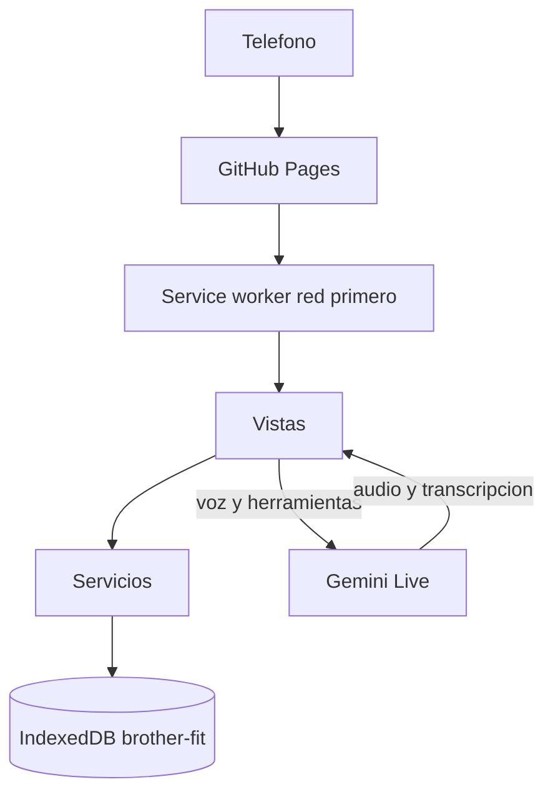

# Brother Fit — sistema

Documento vivo del producto. Describe cómo está armado, dónde vive cada dato y qué no se puede romper. Cuando cambie el comportamiento, el esquema, una pantalla o la forma de publicar, este archivo se actualiza en el mismo cambio.

Última revisión: 20 de octubre de 2026. Base de datos versión 2. Caché de la app `v81`.

## Qué es

Brother Fit es una aplicación web progresiva para registrar entrenos, peso corporal y creatina en el teléfono. Los datos del atleta viven en el navegador, no en un servidor propio. La única pieza que sale del teléfono es Fit, la voz en directo, y solo si el atleta pegó su clave de Gemini.

Se usa con una mano, en vertical, con fondo negro y amarillo eléctrico. El nombre público de la app instalada es «Brother Fit».

- Repositorio: https://github.com/danieth-dev/Brother-Fit.git
- Teléfono: https://danieth-dev.github.io/Brother-Fit/
- Local: desde la carpeta del proyecto, `python -m http.server 8000` y abrir `http://127.0.0.1:8000`. No se abre como archivo suelto: los módulos y el service worker lo exigen.

No hay paso de compilación. El navegador carga HTML, CSS y módulos de JavaScript tal cual están en el repositorio.

## Cómo se actualiza este archivo

Se toca en el mismo cambio que modifica el sistema. No es un diario de cada ajuste visual. Sí se reescribe cuando cambia alguna de estas cosas:

- una pantalla, su ruta o lo que el atleta puede hacer ahí
- una tabla, un campo, un índice o `DB_VERSION`
- una regla de negocio (descanso, semilla de ejercicios, 1RM, creatina, Fit)
- la forma de publicar, la caché o el modelo de voz
- una decisión que, si se olvida, borra datos o duplica historial

## Arquitectura

Las vistas dibujan y escuchan. Los servicios deciden y calculan. `js/db.js` es el único módulo que abre IndexedDB. Las vistas no leen ni escriben tablas por su cuenta, salvo la pantalla de Fit, que guarda la clave de Gemini en `meta` porque esa clave no pertenece al cuaderno de entreno.

```
index.html
  └─ js/main.js          abre la base, siembra ejercicios, carga ajustes, arranca el router
       ├─ js/db.js       IndexedDB brother-fit
       ├─ js/store.js    ajustes en memoria
       ├─ js/router.js   hash → vista
       └─ js/utils/picker.js   listas propias, fuera de #app
            └─ js/views/*       llaman a js/services/*
                 └─ js/services/*   llaman a db
```

Al navegar, el router crea un `<section class="view">` nuevo y tira el anterior. Los listeners y temporizadores de esa pantalla mueren con ella. Si el atleta cambia de ruta mientras una vista todavía está cargando, el resultado viejo se descarta.

La pantalla de entreno se vuelve a dibujar sola al añadir o borrar una serie, sin pasar por el router. El observador de `watchPickers` vuelve a enganchar los `<select>` después de cada reemplazo del HTML.



## Arranque

1. Se bloquea el tirón de recarga de Chrome solo cuando el documento está arriba y ninguna lista interna puede seguir subiendo.
2. Se abre IndexedDB. Si falla, la app avisa y no sigue. Suele pasar en navegación privada.
3. `ensureSeed()` añade los ejercicios del catálogo que todavía no existen. Un nombre ya guardado no se toca y su historial sigue en el mismo id.
4. Se leen los ajustes.
5. Se observan los `<select>` de `#app` para sustituir el menú nativo de Android.
6. El router pinta la ruta del hash.
7. Se pide almacenamiento persistente para que el navegador no borre los datos por falta de espacio.
8. Se registra `sw.js`. Cuando un service worker nuevo toma el control, la página se recarga sola.

## Pantallas

La barra es una isla fija abajo. El historial no tiene icono propio: cuelga de Inicio. Una pulsación larga en cualquier vínculo o botón **nunca** debe abrir el menú del navegador (copiar vínculo, compartir, abrir en Brave): `main.js` cancela `contextmenu` y `dragstart` en captura (salvo campos de texto), marca `draggable=false` en los `<a>` también tras cada repintado, y `base.css` aplica `-webkit-touch-callout: none` a botones, filas, disco, chips y `[data-action]`. Regla de agente: `.cursor/rules/no-browser-link-menu.mdc`.

Los `<select>` de ejercicio, grupo muscular y descanso no usan el menú del sistema. Un botón abre una hoja inferior con la misma paleta. El `<select>` real sigue en el formulario: al elegir, se escribe su valor y se dispara `change`, así que las vistas no saben que la lista es propia. La hoja vive en `document.body`, fuera de `#app`, y se cierra al elegir, al cambiar de ruta o si el control desaparece.

El día del peso corporal y el de una toma de creatina usan la misma hoja, con el mes en curso y el día elegido en amarillo. El `input type="date"` sigue en el formulario y recibe la fecha. El calendario del teléfono no se abre.

| Ruta | Pantalla | Qué hace |
| --- | --- | --- |
| `#/` | Inicio | Resumen de la semana, creatina de hoy y últimos entrenos. Cada entreno abre `#/history/:id`. |
| `#/workout` | Entreno | Una sesión abierta. Si no hay ninguna, el botón la crea. Peso, reps, tipo de serie y cuántas repeticiones más podría haber hecho; descanso; series ya hechas; alta de ejercicio. Los ejercicios del atleta se corrigen o se eliminan desde la lista. |
| `#/history` y `#/history/:id` | Historial | Lista y detalle. Borrar un entreno borra también sus series. |
| `#/progress` y `#/progress/:id` | Progreso | Un ejercicio: PR, comparativa, gráfica y tabla. Abajo, el peso corporal. |
| `#/creatine` | Creatina | Tomas, racha, calendario y saturación. |
| `#/agent` | Fit AI | Voz en directo. Sin clave, solo pide la clave. La charla se guarda en el teléfono; Nuevo chat la borra tras confirmar. |
| `#/settings` | Ajustes | Descanso, recordatorios de agua, respaldo, instalar y borrar todo. |

Si el ejercicio tiene grupo muscular, el nombre lo lleva debajo, en letra pequeña y con un punto de color. También queda bajo el campo ya elegido y junto al nombre en las series registradas. El grupo `Otro` no se muestra: no nombra un músculo. Cuando el grupo se queda corto, la misma línea sigue con la parte concreta en minúscula, por ejemplo «PIERNAS · cuádriceps y glúteo». Eso se ve al elegir y bajo el campo. En las series ya registradas sigue solo el grupo.

Un ejercicio es del atleta cuando su nombre no está en el catálogo. En la lista, esa fila lleva un lápiz justo antes del círculo y fuera de la cápsula amarilla. El nombre sigue eligiendo. El lápiz abre la ficha «Editar ejercicio» (nombre y grupo). Eliminar está en esa ficha, no en la fila: si hay series, la confirmación dice cuántas y se borran con el ejercicio en la misma operación. El catálogo no lleva lápiz. La ficha vive en `document.body`, como las otras hojas.

## Datos

Base `brother-fit`, versión 2. Para una tabla o un índice nuevo se sube `DB_VERSION` y se añade un bloque `if (old < N)` en `migrate()`. No se sube la versión por un cambio de pantalla.

| Tabla | Qué guarda |
| --- | --- |
| `exercises` | `{ id, nombre, grupo }`. El nombre es único. No hay campo de dueño: es del atleta si el nombre no está en el catálogo. |
| `workouts` | `{ id, fecha, startedAt, finishedAt, duracion, notas }`. `fecha` es índice. |
| `sets` | `{ id, workoutId, exerciseId, peso, reps, tipo?, rpe?, ts }`. `tipo` es `trabajo` o `calentamiento`. Índices por entreno y por ejercicio. Una serie vieja sin `tipo` sigue contando en el volumen y en el 1RM estimado, y no pide esfuerzo. |
| `supplements` | `{ id, tipo, fecha, hora, cantidad, ts }`. Hoy `tipo` es `creatina`. |
| `bodyMetrics` | `{ id, fecha, peso, ts }`. |
| `agentMemory` | `{ id, contenido, ts }`. Recuerdos de Fit, no las series. |
| `meta` | Pares `{ key, value }`. Ver la tabla siguiente. |

Claves de `meta`:

| Clave | Valor |
| --- | --- |
| `settings` | `{ descanso, descansoMode, unidad, aguaRecordatorios }`. `unidad` es `kg` o `lb` (preferencia de pantalla). `aguaRecordatorios` es true de fábrica. La toma de creatina es siempre 5 g (`DOSE_G`). |
| `waterReminders` | Plan del día: `{ fecha, items: [{ id, at, body, done }] }`. Avisos locales de agua tras la creatina. |
| `activeWorkoutId` | Id de la sesión abierta. Se borra al terminar o si esa sesión ya está cerrada. |
| `activeRest` | `{ restEnd, lastReps }` del descanso en curso. Si ya venció, se borra al leerlo. |
| `pendingRpe` | Pregunta abierta: `{ setId, mark, attempts, until }`. Se suelta al anotar, al vencer, al crear otra serie, al terminar o descartar, al borrar esa serie, al pasarla a calentamiento o al usar los botones. |
| `rpeSeq` | Entero de la próxima marca. No vuelve a cero al cerrar la pregunta. Solo puede bajar si se importa un respaldo o se borra todo, porque esas dos acciones recargan la página y cortan la sesión de Fit. |
| `seeded` | Marca de que el catálogo ya se intentó. La semilla ya no depende de esta marca para volver a correr. |
| `lastBackup` | Marca de tiempo del último respaldo compartido o descargado. |
| `backupNudgeDay` | Día ISO en que ya se mostró el aviso «Asegura tus PRs». Como máximo una vez al día. |
| `geminiApiKey` | Clave de Gemini. Solo en este teléfono. No va al repositorio ni al respaldo como secreto aparte: viaja dentro del volcado completo de `meta` si se exporta todo. |
| `fitChat` | `{ messages: [{ role, text, ts }], updatedAt }`. Charla visible de Fit. Tope 60 mensajes. No son recuerdos. Se borra solo con Nuevo chat. |

Ajustes de fábrica: descanso manual de 90 s, modo automático, unidad `kg`, recordatorios de agua activos. La creatina del botón es 5 g fijos.

Tras registrar la creatina de hoy, si los recordatorios están activos y el teléfono concede notificaciones, se programan hasta dos avisos locales (aprox. 45 min y 3 h después), sin sonar de noche. Deshacer o borrar la última toma del día cancela el plan. No hay push desde un servidor.

Los pesos de series y peso corporal se guardan siempre en **kg**. En Entreno y en Progreso un segmento `kg | lb` junto al campo Peso cambia `settings.unidad`, convierte el valor del input abierto y muestra historial/PR/volumen en esa unidad (`js/utils/units.js`). Lo ya guardado se interpreta como kg.

Los controles segmentados (`.seg`: tipo de serie, kg/lb, métricas, tipo en historial) se pueden pulsar o arrastrar: la pastilla amarilla se mueve con el dedo y al soltar encaja en la opción más cercana (`js/utils/seg-swipe.js`). Si el `.seg` tiene varias filas (métricas en Progreso), el gesto es libre en 2D. En Progreso, cambiar kg/lb o la métrica del gráfico actualiza números y charts sin remount del `.seg` (si no, parpadea la pastilla). El segmento de unidad no va dentro del `<label>` del input de peso, para no liar el gesto.

El respaldo es un JSON `{ app: "brother-ft", schema: 1, exportedAt, data }`. Al asegurar PRs se intenta `navigator.share` con el archivo; si el teléfono no puede, se descarga como antes. Cancelar la hoja de compartir no actualiza `lastBackup`. Importar reemplaza todas las tablas en una sola transacción: si falla, no queda a medias. Borrar todo es restaurar un volcado vacío.

Aviso de respaldo (`js/utils/backup-nudge.js`): al abrir Inicio o al terminar un entreno, si hay al menos un entreno cerrado y nunca respaldó, o el último respaldo tiene ≥7 días, o hay ≥5 entrenos cerrados desde entonces. Copy: «Asegura tus PRs». No más de una vez al día (`backupNudgeDay`).

## Entrenamiento

Una sesión empieza con `startWorkout()`. Si ya hay una abierta, se reutiliza. Al terminar se escribe `finishedAt` y `duracion`, y se suelta `activeWorkoutId`.

Cada serie dispara el descanso y lo guarda en `meta.activeRest`. Recargar el teléfono no lo borra. El tiempo sale de las repeticiones cuando el modo es automático:

| Reps | Descanso |
| --- | --- |
| 1–5 | 3:00 |
| 6–8 | 2:00 |
| 9–12 | 1:30 |
| 13 o más | 1:00 |

En modo manual se usan los segundos de Ajustes (`descanso`, 90 por defecto).

El 1RM estimado es Epley: si hay una repetición, el peso; si hay más, `peso * (1 + reps / 30)`. El volumen de una serie es peso por repeticiones, también en el calentamiento. El PR de un ejercicio sigue siendo el mayor peso, las mayores reps y el mayor 1RM de Epley. Esa curva no cambia el día que empieza el esfuerzo.

Una serie de trabajo pregunta «¿Cuántas repeticiones más podrías haber hecho?» con cinco botones: 0, 1, 2, 3 y «4 o más». Debajo, «0 es no salía otra». No se copia de la serie anterior. Se guarda `rpe = 10 - rir`, y un 4 o cualquier entero mayor queda en 4, así que el RPE es 6. Ese 6 es un piso, no un punto medio, y no cuenta como serie efectiva. En calentamiento los botones siguen en su sitio, atenuados: «Los calentamientos no llevan esfuerzo». Si había un número elegido, se borra y no vuelve solo al pasar otra vez a trabajo.

La pantalla puede guardar una serie de trabajo sin ese número. Avisa «Serie guardada. Falta esfuerzo» y no abre pregunta: el pendiente significa solo que Fit preguntó en voz alta y espera respuesta. Sí suelta la pregunta que hubiera. Un segundo toque igual, dentro de 8 segundos, no crea otra serie y avisa que ya estaba anotada y que el esfuerzo se añade con «Falta esfuerzo». En el entreno y en el historial esa marca es un botón y abre los cinco. Esos botones sí pisan un esfuerzo ya guardado. Fit no lo pisa.

Fit, si no lo oyó al anotar, abre una pregunta con marca y hace la misma pregunta que la pantalla. El plazo se escribe en ese momento: fin del descanso más un minuto si hay reloj, o cinco minutos si no hay. Saltar el descanso es el único caso que lo reescribe, a un minuto desde ahora, en la misma operación que apaga el reloj. La respuesta entra con `anotar_rpe` y la marca vigente. Una marca vieja no anota y no gasta intento. Un número inválido gasta un intento; al segundo, la serie se queda sin esfuerzo. «No sé» la suelta sin gastar ese intento. Si no hay pregunta, el plazo venció o la serie ya no está, Fit no vuelve a preguntar.

En la semana, al lado del volumen, hay tres cuentas al mismo nivel y solo sobre series de trabajo. Sin esfuerzo: tienen tipo y no tienen RPE. Fáciles: RPE menor que 7. Efectivas: RPE de 7 o más. Las tres suman las series de trabajo. Cada efectiva cuenta una vez, en el grupo de su ejercicio: eso es lo que el documento llama directa, y no parte una serie en varios músculos. Una serie vieja sin tipo no entra en ninguna. Si ahora se le pone tipo, el RPE que ya tenía cae en fácil o en efectiva según el umbral.

El 1RM ajustado es otra métrica, `peso * (1 + (reps + (10 - rpe)) / 30)`. Solo usa series de trabajo cuyo RPE es un entero de 6 a 10. El RPE de una serie sin tipo, o uno fuera de ese rango (un 3, un 12, un 8.5 de cuando el campo era libre), no entra en este cálculo ni se lee como repeticiones de reserva. Si las repeticiones efectivas pasan de 12, ese punto no es fiable.

`rpe-test.html` corre estos casos contra la base `brother-fit-rpe-test` y un reloj que se puede adelantar. No registra el service worker y no abre `brother-fit`.

El catálogo inicial, por grupo:

- Pecho: Press banca, Press inclinado con mancuernas, Aperturas, Press en poleas, Press Hammer, Flexiones
- Espalda: Dominadas, Remo con barra, Jalón al pecho, Peso muerto
- Piernas: Sentadilla, Prensa de piernas, Peso muerto rumano, Zancadas, Extensión de pierna, Sentadilla péndulo
- Hombros: Press militar, Elevaciones laterales
- Bíceps: Curl de bíceps, Curl martillo
- Tríceps: Fondos, Extensión de tríceps, Copa
- Core: Plancha, Crunch en polea

Grupos que el atleta puede elegir al crear uno: Pecho, Espalda, Piernas, Hombros, Bíceps, Tríceps, Core, Cardio, Otro.

La semilla corre en cada arranque. Si el nombre ya existe, se ignora solo el error «Ese ejercicio ya existe.» La comparación distingue mayúsculas. Un nombre distinto crea otro ejercicio y el historial se queda en el id viejo. No se renombra ni se fusiona desde aquí.

Corregir un ejercicio del atleta cambia el nombre y el grupo del mismo id: el historial sigue ahí. No se puede usar un nombre del catálogo ni uno que ya exista. Eliminarlo borra también sus series. Un entreno que se queda sin series sigue en el historial, vacío.

## Creatina

Cada toma es una fila de `supplements` con `tipo: "creatina"`. El disco de Inicio y Creatina es un interruptor: un toque registra 5 g hoy; otro quita todas las tomas de hoy. Un día solo cuenta una toma; la ficha retroactiva no deja añadir otra si ese día ya tiene. La saturación que muestra la app es un modelo simple, no un análisis de laboratorio: 28 días con toma cuentan como saturación, un día saltado no vacía el depósito, y por encima de eso la fase pasa a mantenimiento. La racha no se rompe el mismo día si todavía no se tomó: cuenta desde ayer.

La ciencia que la pantalla explica, y que no hay que contradecir en los textos: sin carga, 3–5 g al día saturan en unas cuatro semanas; con carga, unos 20 g al día durante 5–7 días y luego mantenimiento. La forma de referencia es el monohidrato.

## Progreso y peso corporal

Progreso agrupa las series de un ejercicio por día y muestra el 1RM estimado, el 1RM ajustado, el peso máximo y el volumen. El ajustado no se dibuja en la misma línea que el estimado. La gráfica es un SVG propio (`js/utils/chart.js`). Los números del eje van en el color del texto, no en el negro por defecto del SVG.

El peso corporal es independiente del entreno. Se guarda por fecha y se dibuja con la misma gráfica.

## Fit

En la UI se llama **Fit**. El atleta puede llamarla Fit o Bía: el prompt responde a ambos como un solo personaje. Si preguntan el nombre, dice que pueden usar cualquiera de los dos.

Fit habla por el canal en directo de Gemini, modelo `models/gemini-3.8-live`, voz Aoede, audio de respuesta, 24 kHz PCM16. No se envía `thinkingConfig`. En pantalla solo entra `outputTranscription.text`. El texto de `part.text` es razonamiento interno y no se muestra.

Herramientas que el modelo puede llamar:

| Herramienta | Efecto |
| --- | --- |
| `usar_ejercicio` | Deja Entreno en el ejercicio nombrado, sin anotar una serie. Si no está, o hay varios, no cambia el de la pantalla. |
| `registrar_serie` | Anota la serie en la sesión abierta. Si el atleta nombra el ejercicio, la app lo busca en su lista y Entreno pasa a ese. Si no lo nombra, usa el de la pantalla. Si no está, o hay varios, no anota en otro. Reps de 1 a 100. Peso de 0 a 600; si no viene, usa el de la serie anterior de ese ejercicio. Peso corporal es 0 kg añadidos, no el de la báscula. `tipo` es trabajo si no dicen calentamiento. `rir` responde a cuántas repeticiones más podría haber hecho. Si faltan o no son un entero de 0 para arriba, guarda la serie y abre la pregunta. |
| `anotar_rpe` | No crea filas. Recibe la marca y el `rir`, u `omitir` si el atleta no sabe. La serie la elige `pendingRpe`, no el modelo. |
| `guardar_recuerdo` | Guarda una nota en `agentMemory`. Una serie dicha como carga no se duplica ahí, salvo que hable de dolor, técnica o una meta. |
| `listar_recuerdos` | Devuelve lo guardado. |
| `borrar_recuerdo` | Borra uno por id. |

El nombre lo resuelve la app: ignora mayúsculas y acentos, y acepta el singular si solo hay un ejercicio. Nombrarlo, aunque todavía no haya serie, deja Entreno en ese ejercicio. Un acierto al anotar también lo cambia, aunque el atleta esté en Fit. Cero aciertos o varios no escriben nada y no crean el ejercicio. El peso, si no lo dice, sale de la última serie de ese ejercicio. Fit no pregunta el peso antes de la serie ni dice «lastre». Una segunda llamada igual, de Fit o de la pantalla, sobre la misma serie y el mismo ejercicio dentro de 8 segundos, no escribe otra fila ni abre otra marca. La pantalla lo dice en un aviso. Su criterio de fondo son cuatro pilares: dormir bien, comer bien, hacer ejercicio y no estresarse. Solo los usa si el atleta saca el tema o propone algo que los rompe. No los recita ni los pone por delante de anotar la serie. Durante el descanso Fit no habla por su cuenta. El micrófono se abre de uno en uno: un silencio no dispara dos aperturas, y si el teléfono lo rechaza varias veces seguidas, Fit lo suelta en vez de dejarlo en bucle. Si la pregunta está abierta y el atleta dice 0, cero o ninguna, la app lo anota y ese turno no se lo manda a Fit, para que no lea una nota interna. Pregunta el esfuerzo con las mismas palabras que la pantalla. No sugiere pesos ni cambia el descanso. Los turnos van en español, cortos, sin markdown y sin el razonamiento en inglés. El resumen de la sesión incluye el esfuerzo de cada serie.

La clave se escribe en Ajustes de Fit y queda en `meta.geminiApiKey`. Sin clave no hay sesión de voz. La charla visible vive en `meta.fitChat`. Al cambiar de pestaña, si la sesión sigue abierta, solo se redibuja. Si se cortó, al reconectar se inyecta el historial una vez como contexto y Fit no lo repite. Nuevo chat (icono +) pide confirmación, borra solo esa charla y abre sesión limpia. Los recuerdos no se tocan.

## Interfaz

Tokens en `css/tokens.css`. Fondo `#07080a`, texto `#f8fafc`, amarillo `#ffe600`. Fugaz One es solo la voz de los títulos, en peso 400, para que el navegador no invente una negrita. Números, etiquetas, cuerpo y el reloj usan la fuente de interfaz o la monoespaciada.

La isla de navegación sustituye una barra de borde a borde. El zoom con dos dedos está cerrado en el viewport. `html` y `body` no encadenan el scroll; las listas de la hoja y la de recuerdos de Fit sí se desplazan, con `overscroll-behavior: contain`.

## Publicación

Cada push a `main` dispara `.github/workflows/deploy.yml` y publica la carpeta entera en GitHub Pages. No hay build.

`sw.js` va a la red primero y solo usa la copia local si no hay conexión. Al publicar se sube `VERSION`. Ese cambio de nombre de caché hace que el teléfono suelte la anterior. Para verlo: esperar a que Pages termine, cerrar la app desde las recientes y abrirla de nuevo. No se borran los datos del sitio para forzar la actualización: ahí están los entrenos.

## Qué no se rompe

- No se vacía IndexedDB ni se pide al atleta que borre los datos del sitio para probar un cambio.
- No se sube `DB_VERSION` si no cambia el esquema.
- No se duplica un ejercicio que ya existe con el mismo nombre. El historial pertenece al id, no al texto.
- Los pesos en base están en kg; la unidad de pantalla convierte al mostrar y al escribir.
- No se mezclan el 1RM estimado y el ajustado en la misma curva.
- No se marca «falta esfuerzo» en una serie vieja que no tiene tipo.
- No se muestra `part.text` de Fit ni se manda configuración de pensamiento.
- No se deja que el bloqueo del tirón de recarga cancele el dedo que sube una lista.
- La capa de vistas no abre IndexedDB. El acceso pasa por `js/db.js`.
- Este archivo se actualiza cuando cambia lo que está escrito arriba.

## Mapa de archivos

| Ruta | Papel |
| --- | --- |
| `index.html` | Cascarón, isla y arranque del módulo. |
| `manifest.webmanifest` | Instalación como app. |
| `sw.js` | Caché y versión publicada. |
| `css/tokens.css` | Color, tipo y fuente. |
| `css/base.css` | Página, foco, scroll. |
| `css/components.css` | Controles, listas, gráfica, isla. |
| `js/main.js` | Arranque. |
| `js/db.js` | IndexedDB. |
| `js/store.js` | Ajustes en memoria. |
| `js/router.js` | Rutas. |
| `js/services/workouts.js` | Ejercicios, sesiones, series, descanso, PR y 1RM ajustado. |
| `js/services/effort.js` | Tipo de serie, pregunta de esfuerzo y marcas. |
| `js/services/seed.js` | Catálogo que no pisa lo ya creado. |
| `js/services/body.js` | Peso corporal. |
| `js/services/creatine.js` | Tomas y saturación. |
| `js/services/backup.js` | Exportar e importar. |
| `js/services/agent.js` | Voz, herramientas y recuerdos. |
| `js/services/fit-chat.js` | Charla visible de Fit en `meta.fitChat`. |
| `js/services/water-reminders.js` | Recordatorios locales de agua tras la creatina. |
| `js/views/*.js` | Una pantalla por archivo. |
| `js/utils/picker.js` | Hoja de las listas. |
| `js/utils/exercise-editor.js` | Ficha para corregir o eliminar un ejercicio del atleta. |
| `js/utils/calendar.js` | Hoja del día. |
| `js/utils/time-sheet.js` | Hoja de la hora. Los minutos van de 5 en 5. |
| `js/utils/confirm-sheet.js` | Hoja de confirmación antes de borrar o acciones fuertes. |
| `js/utils/chart.js` | Gráfica SVG. |
| `js/utils/clock.js` | Reloj único. Las pruebas pueden adelantarlo. |
| `js/utils/set-line.js` | Botones de esfuerzo en la serie ya hecha. |
| `rpe-test.html` | Casos del esfuerzo sobre una base temporal. |
| `fonts/FugazOne-Regular.ttf` | Títulos. Licencia en `fonts/OFL.txt`. |
