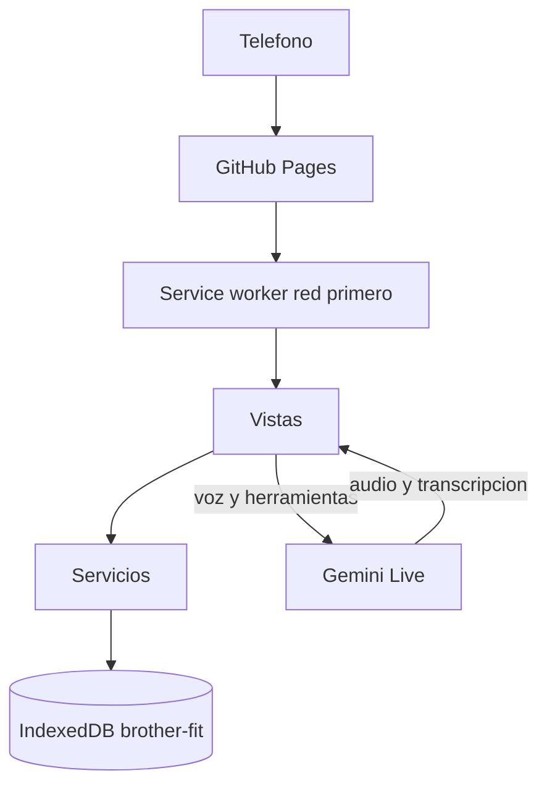

# Brother Fit — sistema

Documento vivo del producto. Describe cómo está armado, dónde vive cada dato y qué no se puede romper. Cuando cambie el comportamiento, el esquema, una pantalla o la forma de publicar, este archivo se actualiza en el mismo cambio.

Última revisión: 14 de octubre de 2026. Base de datos versión 2. Caché de la app `v40`.

## Qué es

Brother Fit es una aplicación web progresiva para registrar entrenos, peso corporal y creatina en el teléfono. Los datos del atleta viven en el navegador, no en un servidor propio. La única pieza que sale del teléfono es Fit, la voz en directo, y solo si el atleta pegó su clave de Gemini.

Se usa con una mano, en vertical, con fondo negro y amarillo eléctrico. El nombre público de la app instalada es «Brother ft».

- Repositorio: https://github.com/danieth-dev/Brother-Fit.git
- Teléfono: https://danieth-dev.github.io/Brother-Fit/
- Local: desde la carpeta del proyecto, `python -m http.server 8000` y abrir `http://127.0.0.1:8000`. No se abre como archivo suelto: los módulos y el service worker lo exigen.

No hay paso de compilación. El navegador carga HTML, CSS y módulos de JavaScript tal cual están en el repositorio.

## Cómo se actualiza este archivo

Se toca en el mismo cambio que modifica el sistema. No es un diario de cada ajuste visual. Sí se reescribe cuando cambia alguna de estas cosas:

- una pantalla, su ruta o lo que el atleta puede hacer ahí
- una tabla, un campo, un índice o `DB_VERSION`
- una regla de negocio (descanso, semilla de ejercicios, 1RM, creatina, Fit)
- la forma de publicar, la caché o el modelo de voz
- una decisión que, si se olvida, borra datos o duplica historial

## Arquitectura

Las vistas dibujan y escuchan. Los servicios deciden y calculan. `js/db.js` es el único módulo que abre IndexedDB. Las vistas no leen ni escriben tablas por su cuenta, salvo la pantalla de Fit, que guarda la clave de Gemini en `meta` porque esa clave no pertenece al cuaderno de entreno.

```
index.html
  └─ js/main.js          abre la base, siembra ejercicios, carga ajustes, arranca el router
       ├─ js/db.js       IndexedDB brother-fit
       ├─ js/store.js    ajustes en memoria
       ├─ js/router.js   hash → vista
       └─ js/utils/picker.js   listas propias, fuera de #app
            └─ js/views/*       llaman a js/services/*
                 └─ js/services/*   llaman a db
```

Al navegar, el router crea un `<section class="view">` nuevo y tira el anterior. Los listeners y temporizadores de esa pantalla mueren con ella. Si el atleta cambia de ruta mientras una vista todavía está cargando, el resultado viejo se descarta.

La pantalla de entreno se vuelve a dibujar sola al añadir o borrar una serie, sin pasar por el router. El observador de `watchPickers` vuelve a enganchar los `<select>` después de cada reemplazo del HTML.



## Arranque

1. Se bloquea el tirón de recarga de Chrome solo cuando el documento está arriba y ninguna lista interna puede seguir subiendo.
2. Se abre IndexedDB. Si falla, la app avisa y no sigue. Suele pasar en navegación privada.
3. `ensureSeed()` añade los ejercicios del catálogo que todavía no existen. Un nombre ya guardado no se toca y su historial sigue en el mismo id.
4. Se leen los ajustes.
5. Se observan los `<select>` de `#app` para sustituir el menú nativo de Android.
6. El router pinta la ruta del hash.
7. Se pide almacenamiento persistente para que el navegador no borre los datos por falta de espacio.
8. Se registra `sw.js`. Cuando un service worker nuevo toma el control, la página se recarga sola.

## Pantallas

La barra es una isla fija abajo. El historial no tiene icono propio: cuelga de Inicio. Una pulsación larga en un icono no abre el menú de vínculos del navegador: la isla cancela ese gesto.

Los `<select>` de ejercicio, grupo muscular, descanso y unidad no usan el menú del sistema. Un botón abre una hoja inferior con la misma paleta. El `<select>` real sigue en el formulario: al elegir, se escribe su valor y se dispara `change`, así que las vistas no saben que la lista es propia. La hoja vive en `document.body`, fuera de `#app`, y se cierra al elegir, al cambiar de ruta o si el control desaparece.

El día del peso corporal y el de una toma de creatina usan la misma hoja, con el mes en curso y el día elegido en amarillo. El `input type="date"` sigue en el formulario y recibe la fecha. El calendario del teléfono no se abre.

| Ruta | Pantalla | Qué hace |
| --- | --- | --- |
| `#/` | Inicio | Resumen de la semana, creatina de hoy y últimos entrenos. Cada entreno abre `#/history/:id`. |
| `#/workout` | Entreno | Una sesión abierta. Si no hay ninguna, el botón la crea. Peso, reps y RPE; descanso; series ya hechas; alta de ejercicio. Los ejercicios del atleta se corrigen o se eliminan desde la lista. |
| `#/history` y `#/history/:id` | Historial | Lista y detalle. Borrar un entreno borra también sus series. |
| `#/progress` y `#/progress/:id` | Progreso | Un ejercicio: PR, comparativa, gráfica y tabla. Abajo, el peso corporal. |
| `#/creatine` | Creatina | Tomas, racha, calendario y saturación. |
| `#/agent` | Fit AI | Voz en directo. Sin clave, solo pide la clave. |
| `#/settings` | Ajustes | Gramos, descanso, unidad, respaldo, instalar y borrar todo. |

Si el ejercicio tiene grupo muscular, el nombre lo lleva debajo, en letra pequeña y con un punto de color. También queda bajo el campo ya elegido y junto al nombre en las series registradas. El grupo `Otro` no se muestra: no nombra un músculo.

Un ejercicio es del atleta cuando su nombre no está en el catálogo. En la lista, esa fila lleva un lápiz justo antes del círculo y fuera de la cápsula amarilla. El nombre sigue eligiendo. El lápiz abre la ficha «Editar ejercicio» (nombre y grupo). Eliminar está en esa ficha, no en la fila: si hay series, la confirmación dice cuántas y se borran con el ejercicio en la misma operación. El catálogo no lleva lápiz. La ficha vive en `document.body`, como las otras hojas.

## Datos

Base `brother-fit`, versión 2. Para una tabla o un índice nuevo se sube `DB_VERSION` y se añade un bloque `if (old < N)` en `migrate()`. No se sube la versión por un cambio de pantalla.

| Tabla | Qué guarda |
| --- | --- |
| `exercises` | `{ id, nombre, grupo }`. El nombre es único. No hay campo de dueño: es del atleta si el nombre no está en el catálogo. |
| `workouts` | `{ id, fecha, startedAt, finishedAt, duracion, notas }`. `fecha` es índice. |
| `sets` | `{ id, workoutId, exerciseId, peso, reps, rpe?, ts }`. Índices por entreno y por ejercicio. |
| `supplements` | `{ id, tipo, fecha, hora, cantidad, ts }`. Hoy `tipo` es `creatina`. |
| `bodyMetrics` | `{ id, fecha, peso, ts }`. |
| `agentMemory` | `{ id, contenido, ts }`. Recuerdos de Fit, no las series. |
| `meta` | Pares `{ key, value }`. Ver la tabla siguiente. |

Claves de `meta`:

| Clave | Valor |
| --- | --- |
| `settings` | `{ creatinaGramos, descanso, descansoMode, unidad }`. |
| `activeWorkoutId` | Id de la sesión abierta. Se borra al terminar o si esa sesión ya está cerrada. |
| `activeRest` | `{ restEnd, lastReps }` del descanso en curso. Si ya venció, se borra al leerlo. |
| `seeded` | Marca de que el catálogo ya se intentó. La semilla ya no depende de esta marca para volver a correr. |
| `lastBackup` | Marca de tiempo del último JSON exportado. |
| `geminiApiKey` | Clave de Gemini. Solo en este teléfono. No va al repositorio ni al respaldo como secreto aparte: viaja dentro del volcado completo de `meta` si se exporta todo. |

Ajustes de fábrica: 5 g de creatina, descanso manual de 90 s, modo automático, unidad `kg`.

Cambiar de kg a lb solo cambia la etiqueta. Los números ya guardados no se convierten.

El respaldo es un JSON `{ app: "brother-ft", schema: 1, exportedAt, data }`. Importar reemplaza todas las tablas en una sola transacción: si falla, no queda a medias. Borrar todo es restaurar un volcado vacío.

## Entrenamiento

Una sesión empieza con `startWorkout()`. Si ya hay una abierta, se reutiliza. Al terminar se escribe `finishedAt` y `duracion`, y se suelta `activeWorkoutId`.

Cada serie dispara el descanso y lo guarda en `meta.activeRest`. Recargar el teléfono no lo borra. El tiempo sale de las repeticiones cuando el modo es automático:

| Reps | Descanso |
| --- | --- |
| 1–5 | 3:00 |
| 6–8 | 2:00 |
| 9–12 | 1:30 |
| 13 o más | 1:00 |

En modo manual se usan los segundos de Ajustes (`descanso`, 90 por defecto).

El 1RM estimado es Epley: si hay una repetición, el peso; si hay más, `peso * (1 + reps / 30)`. El volumen de una serie es peso por repeticiones. El PR de un ejercicio es el mayor peso, las mayores reps y el mayor 1RM de todas sus series.

El catálogo inicial, por grupo:

- Pecho: Press banca, Press inclinado con mancuernas, Aperturas, Press en poleas, Press Hammer
- Espalda: Dominadas, Remo con barra, Jalón al pecho, Peso muerto
- Piernas: Sentadilla, Prensa de piernas, Peso muerto rumano, Zancadas
- Hombros: Press militar, Elevaciones laterales
- Bíceps: Curl de bíceps, Curl martillo
- Tríceps: Fondos, Extensión de tríceps
- Core: Plancha, Crunch en polea

Grupos que el atleta puede elegir al crear uno: Pecho, Espalda, Piernas, Hombros, Bíceps, Tríceps, Core, Cardio, Otro.

La semilla corre en cada arranque. Si el nombre ya existe, se ignora solo el error «Ese ejercicio ya existe.» La comparación distingue mayúsculas. Un nombre distinto crea otro ejercicio y el historial se queda en el id viejo. No se renombra ni se fusiona desde aquí.

Corregir un ejercicio del atleta cambia el nombre y el grupo del mismo id: el historial sigue ahí. No se puede usar un nombre del catálogo ni uno que ya exista. Eliminarlo borra también sus series. Un entreno que se queda sin series sigue en el historial, vacío.

## Creatina

Cada toma es una fila de `supplements` con `tipo: "creatina"`. La saturación que muestra la app es un modelo simple, no un análisis de laboratorio: 28 días con toma cuentan como saturación, un día saltado no vacía el depósito, y por encima de eso la fase pasa a mantenimiento. La racha no se rompe el mismo día si todavía no se tomó: cuenta desde ayer.

La ciencia que la pantalla explica, y que no hay que contradecir en los textos: sin carga, 3–5 g al día saturan en unas cuatro semanas; con carga, unos 20 g al día durante 5–7 días y luego mantenimiento. La forma de referencia es el monohidrato.

## Progreso y peso corporal

Progreso agrupa las series de un ejercicio por día y muestra tres métricas: 1RM estimado, peso máximo y volumen. La gráfica es un SVG propio (`js/utils/chart.js`). Los números del eje van en el color del texto, no en el negro por defecto del SVG.

El peso corporal es independiente del entreno. Se guarda por fecha y se dibuja con la misma gráfica.

## Fit

Fit habla por el canal en directo de Gemini, modelo `models/gemini-3.8-live`, voz Aoede, audio de respuesta, 24 kHz PCM16. No se envía `thinkingConfig`. En pantalla solo entra `outputTranscription.text`. El texto de `part.text` es razonamiento interno y no se muestra.

Herramientas que el modelo puede llamar:

| Herramienta | Efecto |
| --- | --- |
| `registrar_serie` | Anota reps, peso y RPE en la sesión abierta y en el ejercicio que está en pantalla. Reps de 1 a 100. Peso de 0 a 600; si no viene, usa el de la serie anterior. RPE de 1 a 10. |
| `guardar_recuerdo` | Guarda una nota en `agentMemory`. Una serie dicha como carga no se duplica ahí, salvo que hable de dolor, técnica o una meta. |
| `listar_recuerdos` | Devuelve lo guardado. |
| `borrar_recuerdo` | Borra uno por id. |

Una segunda llamada igual, sobre la misma serie y dentro de 8 segundos, no escribe otra fila. Fit no habla por su cuenta durante el descanso: solo si el atleta pregunta o si la app le inyecta una orden. Los turnos van en español, cortos, sin markdown y sin el razonamiento en inglés.

La clave se escribe en Ajustes de Fit y queda en `meta.geminiApiKey`. Sin clave no hay sesión de voz.

## Interfaz

Tokens en `css/tokens.css`. Fondo `#07080a`, texto `#f8fafc`, amarillo `#ffe600`. Fugaz One es solo la voz de los títulos, en peso 400, para que el navegador no invente una negrita. Números, etiquetas, cuerpo y el reloj usan la fuente de interfaz o la monoespaciada.

La isla de navegación sustituye una barra de borde a borde. El zoom con dos dedos está cerrado en el viewport. `html` y `body` no encadenan el scroll; las listas de la hoja y la de recuerdos de Fit sí se desplazan, con `overscroll-behavior: contain`.

## Publicación

Cada push a `main` dispara `.github/workflows/deploy.yml` y publica la carpeta entera en GitHub Pages. No hay build.

`sw.js` va a la red primero y solo usa la copia local si no hay conexión. Al publicar se sube `VERSION`. Ese cambio de nombre de caché hace que el teléfono suelte la anterior. Para verlo: esperar a que Pages termine, cerrar la app desde las recientes y abrirla de nuevo. No se borran los datos del sitio para forzar la actualización: ahí están los entrenos.

## Qué no se rompe

- No se vacía IndexedDB ni se pide al atleta que borre los datos del sitio para probar un cambio.
- No se sube `DB_VERSION` si no cambia el esquema.
- No se duplica un ejercicio que ya existe con el mismo nombre. El historial pertenece al id, no al texto.
- No se convierte el peso al cambiar la unidad.
- No se muestra `part.text` de Fit ni se manda configuración de pensamiento.
- No se deja que el bloqueo del tirón de recarga cancele el dedo que sube una lista.
- La capa de vistas no abre IndexedDB. El acceso pasa por `js/db.js`.
- Este archivo se actualiza cuando cambia lo que está escrito arriba.

## Mapa de archivos

| Ruta | Papel |
| --- | --- |
| `index.html` | Cascarón, isla y arranque del módulo. |
| `manifest.webmanifest` | Instalación como app. |
| `sw.js` | Caché y versión publicada. |
| `css/tokens.css` | Color, tipo y fuente. |
| `css/base.css` | Página, foco, scroll. |
| `css/components.css` | Controles, listas, gráfica, isla. |
| `js/main.js` | Arranque. |
| `js/db.js` | IndexedDB. |
| `js/store.js` | Ajustes en memoria. |
| `js/router.js` | Rutas. |
| `js/services/workouts.js` | Ejercicios, sesiones, series, descanso, PR. |
| `js/services/seed.js` | Catálogo que no pisa lo ya creado. |
| `js/services/body.js` | Peso corporal. |
| `js/services/creatine.js` | Tomas y saturación. |
| `js/services/backup.js` | Exportar e importar. |
| `js/services/agent.js` | Voz, herramientas y recuerdos. |
| `js/views/*.js` | Una pantalla por archivo. |
| `js/utils/picker.js` | Hoja de las listas. |
| `js/utils/exercise-editor.js` | Ficha para corregir o eliminar un ejercicio del atleta. |
| `js/utils/calendar.js` | Hoja del día. |
| `js/utils/chart.js` | Gráfica SVG. |
| `fonts/FugazOne-Regular.ttf` | Títulos. Licencia en `fonts/OFL.txt`. |
